# 🎬 Menoid V1 — the demo

Menoid V1 is the private app in the browser — [app.menoid.xyz](https://app.menoid.xyz), live on
**Monad** and **Base** mainnets (testnets at [testnet.menoid.xyz](https://testnet.menoid.xyz)).
It is the **compliance-friendly multichain privacy layer**: your funds move privately, and a
viewing key lets anyone you choose see — never spend — your activity.

What follows is one real session on Monad mainnet, from opening the app to proving the
history with a viewing key.

> [← back to the README](README.md)

---

## 1. Open the app

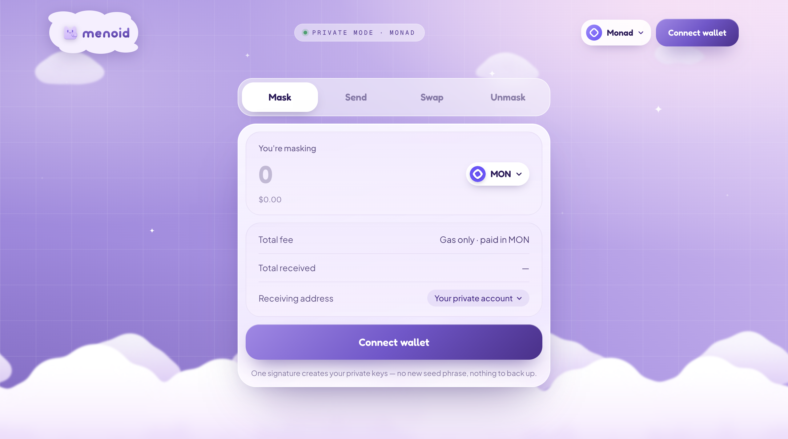

Mask, Send, Swap and Unmask are all on show from the start. The button under the panel always
says what comes next — here, **Connect wallet**. The network sits top right.

## 2. Choose a wallet

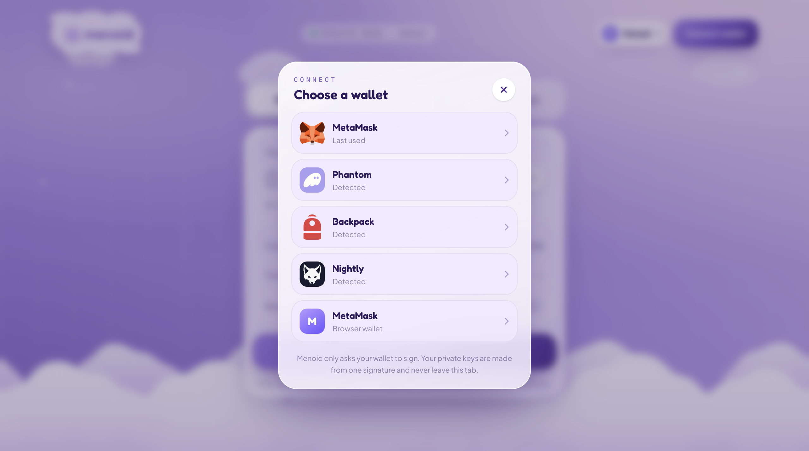

Every installed wallet announces itself (EIP-6963) — MetaMask, Phantom, Backpack, Nightly…
Menoid only ever asks it to **sign**: one signature, and your private keys are derived from it
inside this tab. No new seed phrase, nothing to back up, and the keys never leave the browser.

## 3. Register — once

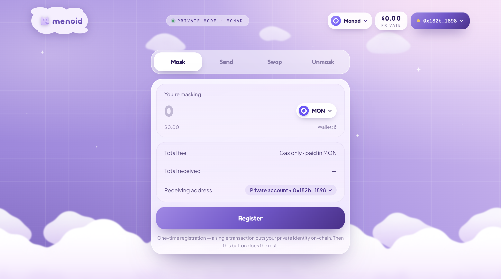

A new account registers once: a single transaction puts your private identity on-chain (a
commitment to your keys and your public viewing key — never the keys themselves). After that,
the same button does everything else.

## 4. Your private account opens

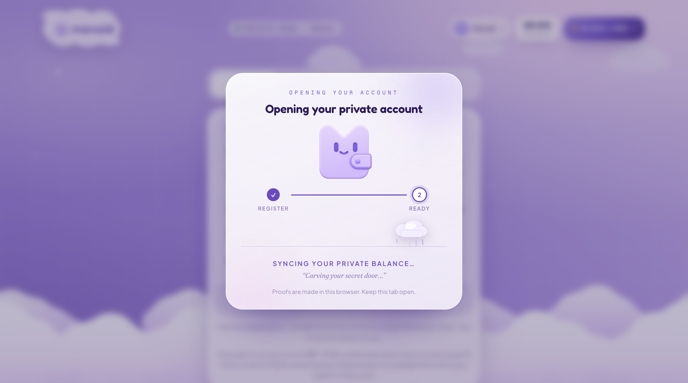

The app waits for the transaction, then syncs your private balance from the pool's events.
Everything is decrypted here, in the browser.

## 5. Mask — public funds into a private balance

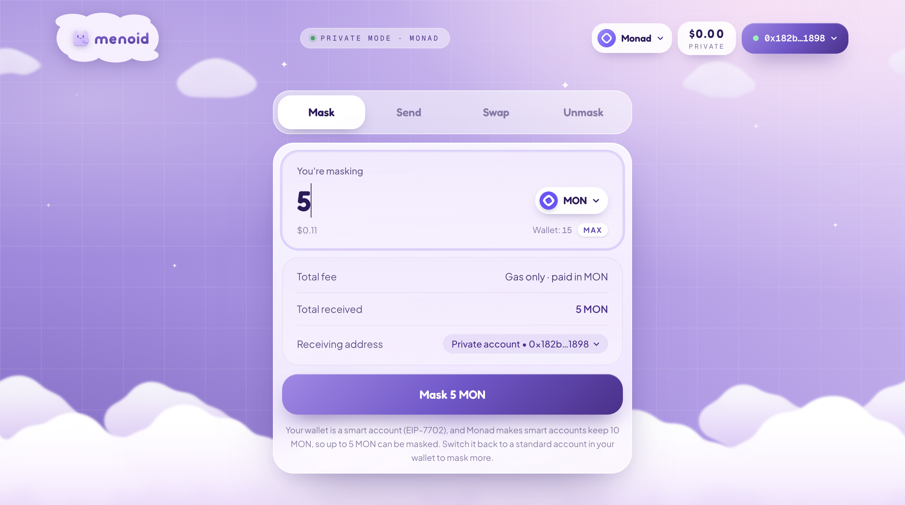

**Mask** moves tokens from your public wallet into the pool, as a note only you can open. Gas is
the only cost. (On Monad, a wallet that is a smart account must keep 10 MON — the app says so and
shows how much can be masked.)

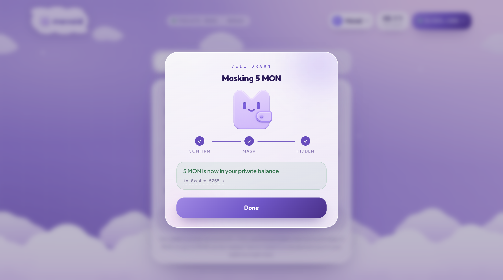

Hidden: the 5 MON are now a private note, and your private balance shows them.

## 6. Send privately

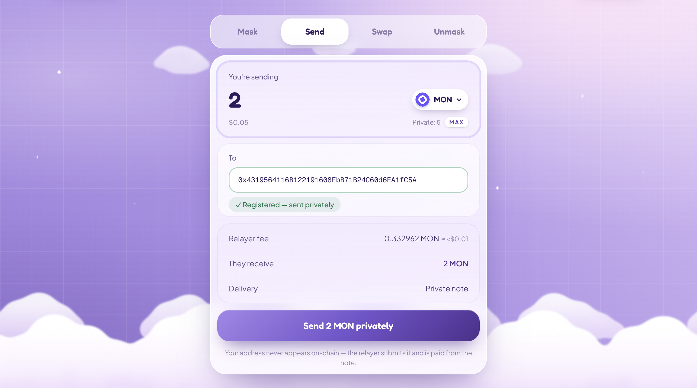

**Send** pays any registered address from your private balance. The zero-knowledge proof is
made in your browser; a relayer submits it and is paid from the note itself — so **your address
never appears on-chain**, and nobody can link the payment to you. The app checks the recipient
is registered before you send.

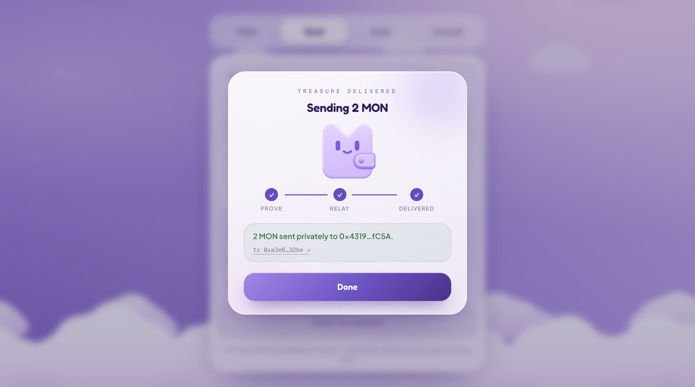

Proved, relayed, delivered — the recipient finds a new private note.

## 7. Swap privately

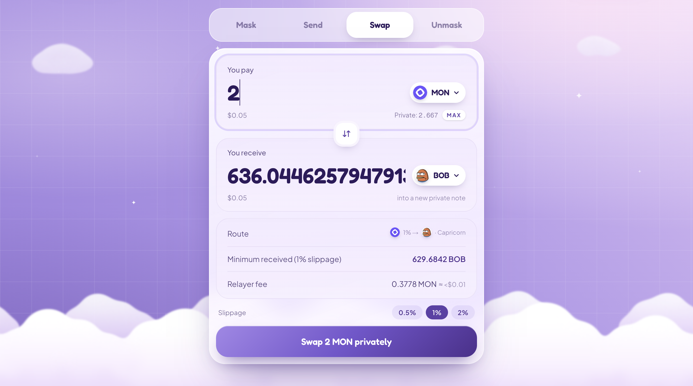

**Swap** trades inside the pool: the pool itself swaps on Uniswap V3 — or on Capricorn,
nad.fun's DEX, where Monad's memecoins trade — and what you buy lands as a new private note.
Menoid picks the best route across both; the proof binds it, the minimum and the deadline.

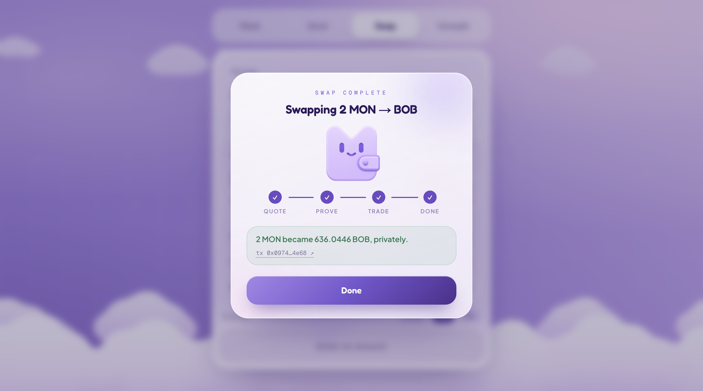

2 MON became 636 BOB, privately.

## 8. Unmask

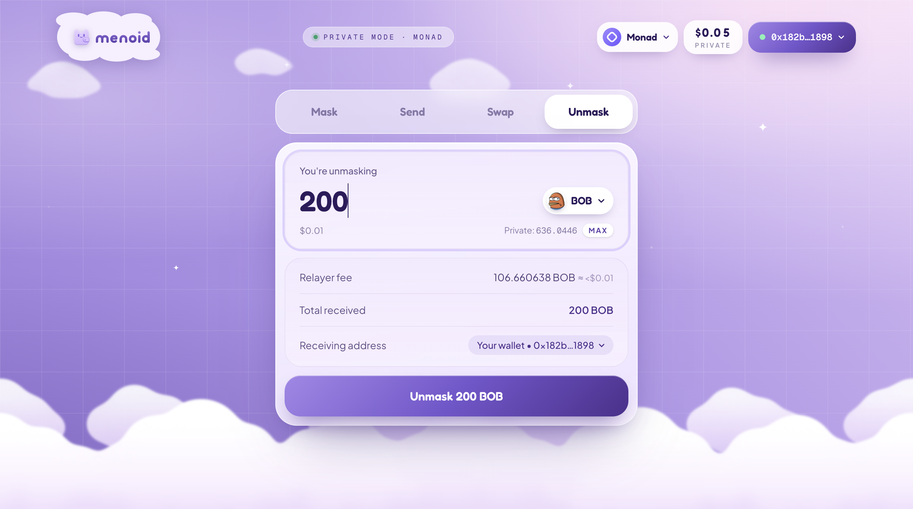

**Unmask** sends private funds back to a public address — your own wallet or anyone else's —
whenever you choose. The relayer submits it; its fee comes out of the note.

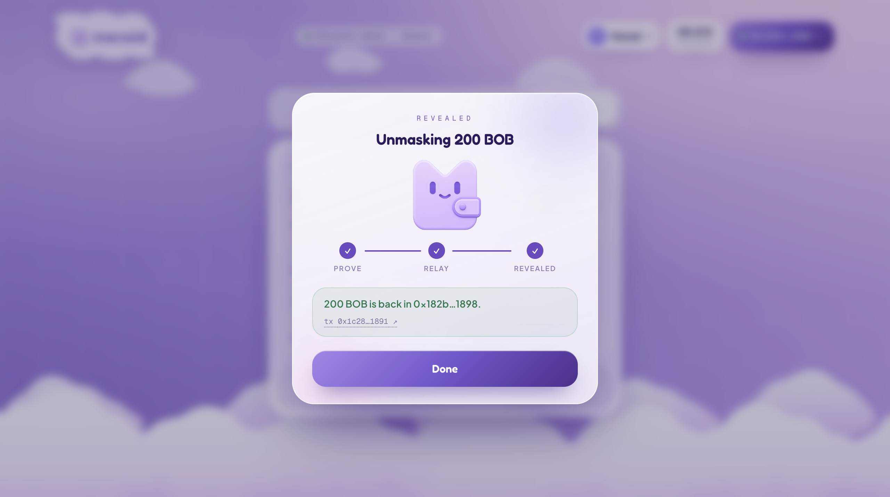

200 BOB are back in the public wallet.

## 9. Your account

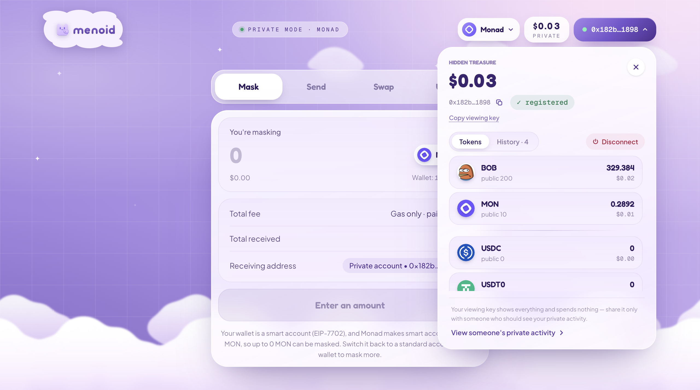

Click the address: the **hidden treasure**. Private balances token by token — the ones you hold
first — with your public balance beside each, your full private history, and **Copy viewing key**.

## 10. Compliance-friendly by design: viewing keys

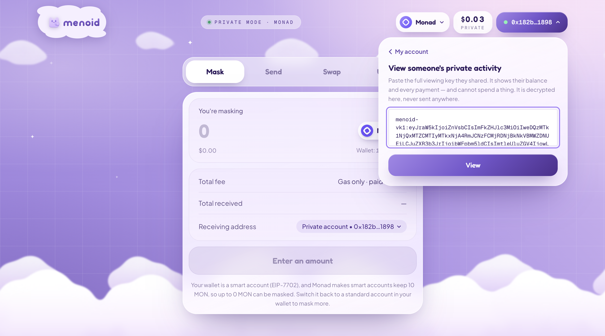

A **full viewing key** shows everything and spends nothing. Share yours with an auditor, an
exchange or anyone who should see your activity; paste someone's into **View someone's private
activity** to see theirs. It is decrypted in your browser, never sent anywhere.

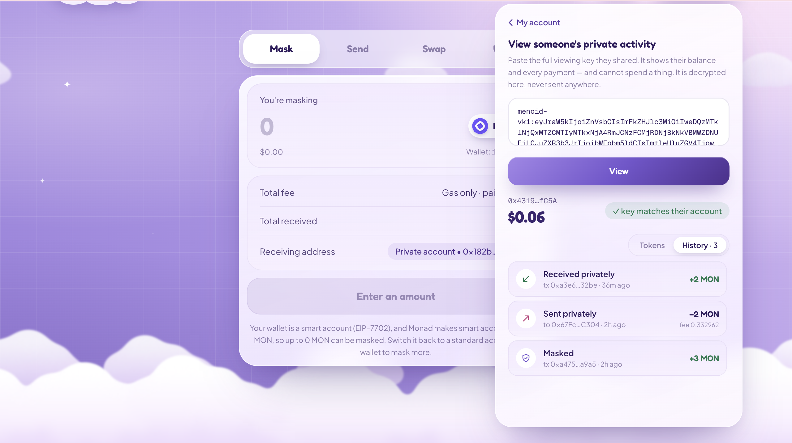

Their balance and every payment — received, sent, masked — with a check that the key really
matches their on-chain account. Privacy by default, transparency by choice.

---

**Menoid — the compliance-friendly multichain privacy layer.** [menoid.xyz](https://menoid.xyz)
